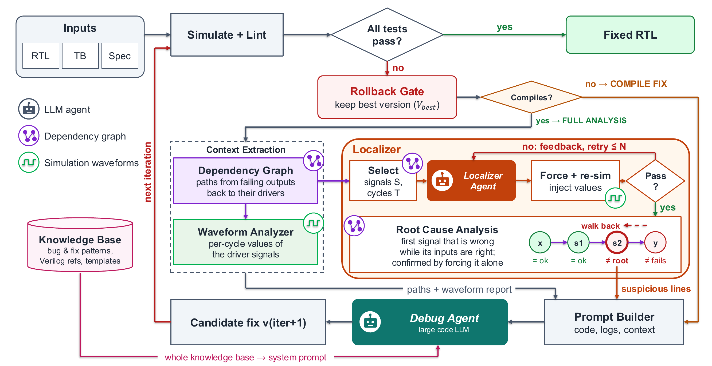

# RTLDetective

**Agentic RTL Debugging through Dataflow Analysis and Simulation-Guided Fault Localization**

Neusha Javidnia, Ruisi Zhang, Farinaz Koushanfar

RTLDetective is a multi-agent framework for automated RTL debugging and repair. It builds a
signal dependency graph from the RTL, extracts failure context from waveform traces, and uses a
lightweight **Localizer Agent** to predict the values that internal signals should have. It then
tests those predictions by forcing them in simulation. A **Debug Agent** combines the localized
faults with static analysis, a curated knowledge base of RTL bug patterns and the design
specification to generate repairs. The repairs are checked with the testbench.

On the MEIC benchmark (194 bugs), RTLDetective reaches an **86.1% fix rate**, 13.9 percentage
points above the best baseline, using the same open-weight 30B model as the baselines.



*Figure 1. Overview of RTLDetective. Each iteration evaluates the current RTL candidate through
compilation, static analysis and simulation. Context Extraction builds a signal dependency graph,
traces dependencies backward from failing outputs, and summarizes the waveforms leading up to the
first failure. The Localizer Agent predicts expected values of intermediate signals and tests them
through counterfactual simulation. Root Cause Analysis uses the validated predictions to find
suspicious logic. The Debug Agent uses the localized fault information and the RTL debugging
knowledge base to generate the next repair candidate. A rollback gate keeps the best version
found so far.*

---

## Contents

- [Installation](#installation)
- [Quick start](#quick-start)
- [Reproducing the paper results](#reproducing-the-paper-results)
- [Repository layout](#repository-layout)
- [Configuration](#configuration)
- [Other backends](#other-backends)
- [Citation](#citation)

---

## Installation

### Requirements

| Component | Version / notes |
|---|---|
| OS | Linux (tested on Ubuntu) |
| Python | 3.10 or newer |
| Simulator | [Icarus Verilog](https://steveicarus.github.io/iverilog/) 13.0 (`iverilog`, `vvp`) |
| GPUs (paper setup) | 3 × NVIDIA RTX A6000 (48 GB): two for the Debug Agent, one for the Localizer Agent |

### 1. Clone

```bash
git clone https://github.com/ACESLabUCSD/RTLDetective.git
cd RTLDetective
```

### 2. Install Icarus Verilog

Version 13.0 was used in the paper. Some distributions ship older versions. You can build
it from source ([instructions](https://steveicarus.github.io/iverilog/usage/installation.html)) or
use the package manager:

```bash
sudo apt install iverilog
```

```bash
iverilog -V | head -1
```

### 3. Create the Python environment

`run.sh` creates a virtual environment in `./verilog_debug/` and installs the dependencies.
The paper results use the vLLM backend:

```bash
./run.sh install-vllm
```

```bash
source verilog_debug/bin/activate
```

```bash
./run.sh check-env
```

This installs `requirements.txt` plus `vllm`, `transformers` and `accelerate`. If you only want
a remote API model, `./run.sh install` installs the base dependencies (see
[Other backends](#other-backends)).

### 4. Point the config at your GPUs

In [`config.yaml`](config.yaml), set:

- `local_model.cache_dir`: where model weights are downloaded (about 60 GB for Qwen3-Coder-30B-A3B).
- `local_model.gpu_ids`: GPUs for the Debug Agent's vLLM server (the paper uses `"0,1"`).
- `localizer.gpu_ids`: GPU for the Localizer Agent's vLLM server (the paper uses `"2"`).

Lower `vllm.gpu_memory_utilization` or `localizer.gpu_memory_utilization` if the GPUs are shared.

---

## Quick start

Debug one buggy MEIC design with the full pipeline (waveform analysis and localizer on). The
first run starts the vLLM servers and downloads the models, which takes a while.

```bash
python -m agent.debug_agent testset/MEIC_Testset/accu/buggy/accu_func_logic_error.v \
    --testbench testset/MEIC_Testset/accu/benchmarks/tb.v \
    --model qwen-coder-30b --backend vllm \
    --waveform --localize --max-loops 3 \
    --output-dir output/quickstart
```

The agent writes a JSON report, a log and the repaired RTL (`*_fixed.v`) to the output folder.
The design specification (`design_description.txt`) is found automatically next to the module.

To run all bugs of one design:

```bash
./run_MEIC_batch.sh --modules accu --output-dir output/quickstart_accu
```

Other useful commands:

```bash
./run.sh lint testset/MEIC_Testset/accu/buggy/accu_func_logic_error.v
```

```bash
./run.sh bench testset/MEIC_Testset/accu/buggy/accu_func_logic_error.v testset/MEIC_Testset/accu/benchmarks/tb.v
```

The first runs only the rule-based static analyzer (no LLM). The second runs the testbench and
prints the pass rate.

---

## Run the full benchmark

[`run_MEIC_batch.sh`](run_MEIC_batch.sh) runs the agent on every buggy file in
`testset/MEIC_Testset/`. It starts one shared vLLM server for the whole batch and stops it at the
end. The full pipeline (waveform analysis and localizer) is on by default.

**3 iterations** (Table I, row "RTLDetective, 3 iter."):

```bash
./run_MEIC_batch.sh --max-loops 3 --seed 0 --output-dir output/rtldetective
```

Useful options:

| Option | Effect |
|---|---|
| `--modules accu alu` | Run only some designs |
| `--resume` | Skip bugs that already have a report (to continue an interrupted run) |
| `--seed N` | Base sampling seed |
| `--timeout S` | Per-bug timeout in seconds (default 3600) |
| `--save-prompts` | Also save every LLM request and reply |

Each bug produces `output/<run>/<design>/<bug>_report.json`, `<bug>_log.txt` and `<bug>_fixed.v`.
The script prints the number of fixed bugs at the end.

### Paper Results (Table I of the paper)

| Method | Budget | Syntax FR | Functional FR | Overall |
|---|---|---|---|---|
| Qwen, no agent | 1 call | 44.2% | 35.8% | 79/194 (40.7%) |
| UVLLM | 4+4 iter. | 61.9% | 54.3% | 114/194 (58.8%) |
| MEIC | 3 iter. | 74.3% | 63.0% | 135/194 (69.6%) |
| MEIC | 10 iter. | 74.3% | 69.1% | 140/194 (72.2%) |
| **RTLDetective** | 3 iter. | 87.6% | 71.6% | 157/194 (80.9%) |
| **RTLDetective** | 10 iter. | **93.8%** | **74.1%** | **167/194 (86.1%)** |

---

## Repository layout

```
RTLDetective/
├── run.sh                    # Convenience wrapper: install, check-env, debug, meic, lint, bench, ...
├── run_MEIC_batch.sh         # Runs the agent on the whole MEIC benchmark
├── config.yaml               # Models, vLLM servers, localizer, sampling, simulator settings
├── requirements.txt
│
├── agent/
│   ├── debug_agent.py        # Debug Agent: multi-iteration repair loop with rollback
│   ├── predict_force.py      # Localizer Agent: predict, force and re-simulate, root cause analysis
│   ├── verilog_tracer.py     # Hierarchical signal dependency graph (Pyverilog)
│   ├── waveform.py           # VCD analysis: compact transition table of the failure window
│   ├── memory_loader.py      # Loads the knowledge base into the system prompt
│   └── backends/             # LLM clients: vLLM (server and client), HuggingFace, OpenRouter
│
├── tools/
│   ├── static_analyzer.py    # Rule-based RTL linter (8 bug-pattern rules)
│   ├── benchmark_runner.py   # Compiles and simulates with the testbench, scores pass rate
│   └── test_runner.py
│
├── memory/                   # Knowledge base: bug and fix patterns, Verilog references, templates
├── skills/SKILL.md           # Structured debugging procedure given to the Debug Agent
│
├── testset/
│   ├── MEIC_Testset/         # 15 designs × {spec, testbench, buggy/*.v}: 194 bugs
│   └── ACES/                 # Larger multi-file designs (e.g. xge_mac)
├── samples/                  # Small example bugs and testbenches
├── scripts/                  # Batch runner and report evaluation helpers
└── docs/figure1_overview.png
```

Outputs are written to `output/` and are not tracked by git.

---

## Configuration

Most of the behavior is controlled by [`config.yaml`](config.yaml):

- `vllm:`: server port, sampling settings (temperature, top-p, seed, max tokens), tensor parallelism
  and context length for the Debug Agent. Sampling settings apply on the next request. Server
  settings apply after a restart:

  ```bash
  python -m agent.backends.vllm_server stop
  ```

- `localizer:`: Localizer Agent model, GPU, number of predict-and-force rounds (`rounds`), cycle
  window and maximum number of signals.
- `agent.max_loops`: default number of repair iterations.
- `simulation:` and `evaluation:`: simulator and timeouts.

---

## Other backends

RTLDetective can also run without vLLM:

- **HuggingFace transformers** (`--backend hf`): `./run.sh install-local`, then for example
  `./run.sh debug-local samples/buggy/counter_4bit.v`.
- **Remote models through OpenRouter** (`--backend openrouter`): copy `.env.example` to `.env`,
  set `OPENROUTER_API_KEY`, then for example
  `python -m agent.debug_agent samples/buggy/alu_simple.v --model claude-sonnet --backend openrouter`.

The paper's results were produced with the vLLM backend only. `./run.sh models` lists the model
shortcuts.

---

## Citation

If you use RTLDetective, please cite:

```bibtex
@article{javidnia2026rtldetective,
  title   = {{RTLDetective}: Agentic {RTL} Debugging through Dataflow Analysis and
             Simulation-Guided Fault Localization},
  author  = {Javidnia, Neusha and Zhang, Ruisi and Koushanfar, Farinaz},
  year    = {2026}
}
```

## Contact

Neusha Javidnia, njavidnia@ucsd.edu
